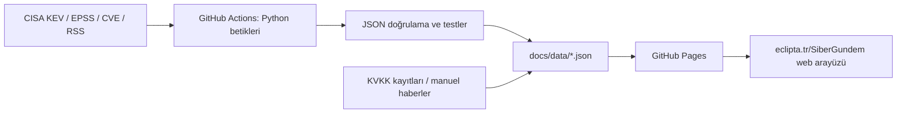

# Siber Gündem — Eclipta Cyber Threats

Türkiye ve dünyadaki siber güvenlik gelişmelerini izlemek için kullanılan açık erişimli veri ve web arayüzü projesi. [Siber Gündem](https://eclipta.tr/SiberGundem/) sayfası; güvenlik ekipleri, BT yöneticileri, danışmanlar ve ilgili okuyucular için hazırlanmıştır.

## Neler izleniyor?

- **CISA KEV:** Bilinen aktif istismar edilen CVE kayıtları, üretici/ürün eşlemesi.
- **FIRST EPSS ve CVSS:** Uygun olduğunda KEV kayıtlarının olasılık ve önem skorlarıyla zenginleştirilmesi; eksik skorlar `null` olarak korunur.
- **Güvenlik haberleri:** Yapılandırılabilir RSS/Atom kaynaklarının başlık, bağlantı, kaynak ve tarih bilgisi.
- **KVKK:** Ayrı JSON dosyalarında tutulan, resmi duyurulara bağlantılı veri ihlali kayıtları.

Bu proje bir güvenlik tarayıcısı değildir; kaynaklardaki içeriklerin yayınlanması doğruluk garantisi veya profesyonel risk değerlendirmesi anlamına gelmez.

## Gerçek mimari



GitHub Pages veri dosyalarını yayınlar. `web/tehdit/index.html` Eclipta web sitesinde kullanılan arayüz dosyasıdır. Üretim alan adı ve GitHub Pages uç noktası dağıtım yapılandırmasına göre doğrulanmalıdır.

## Dizinler

| Yol | İşlev |
| --- | --- |
| `scripts/fetch_kev.py` | KEV, EPSS ve CVSS veri toplama |
| `scripts/fetch_news.py` | RSS/Atom haber toplama |
| `scripts/validate_json.py` | JSON sözdizimi ve KEV/haber şema doğrulaması |
| `schemas/` | Yayımlanan otomatik veri dosyalarının JSON Schema tanımları |
| `docs/data/` | GitHub Pages üzerinden yayınlanan veri |
| `config/` | Üretici ve RSS kaynak yapılandırması |
| `web/tehdit/` | Bağımsız web sayfası |
| `.github/workflows/` | Otomatik veri güncelleme ve KVKK doğrulaması |

## Yerel geliştirme

Python 3.10+ gerekir. GitHub Actions Python 3.12 kullanır.

```bash
git clone https://github.com/YagmurEr/EcliptaCyberThreats.git
cd EcliptaCyberThreats
python3 -m venv .venv
source .venv/bin/activate
python -m pip install -r requirements.txt
python -m unittest discover -s tests -v
python scripts/validate_json.py
```

Windows üzerinde sanal ortamı `.venv\\Scripts\\activate` ile etkinleştirin. Gerçek veri güncellemeleri internet bağlantısı gerektirir ve `docs/data` dosyalarını değiştirir; kaynakları sorgulamak için ayrıca `python scripts/fetch_kev.py` ve `python scripts/fetch_news.py` çalıştırılabilir.

## Veri doğrulama ve yayınlama

`veri-guncelle.yml` KEV'yi günlük, RSS haberlerini günde dört kez toplar. Birim testleri ve JSON doğrulaması başarısızsa otomatik veri commit'i yapılmaz. KVKK için ayrıca mevcut `kvkk-veri-dogrulama.yml` denetimi bulunur. Şema kontrolleri `kev.json` ile `haberler_otomatik.json` dosyalarının yapısını; diğer JSON dosyalarının geçerli biçimde olup olmadığını kontrol eder.

## Katkı ve sürümler

Katkılar için [CONTRIBUTING.md](CONTRIBUTING.md), değişiklikler için [CHANGELOG.md](CHANGELOG.md) dosyasına bakın. Uygulama sürümü `VERSION.json` içinde kayıtlıdır. GitHub Release oluşturulmadan yalnızca bu dosyadaki sürümün bulunması bir Release yayımlandığı anlamına gelmez.

## Lisans ve kaynak kullanımı

**Önemli:** Depoda henüz bir yazılım lisansı (`LICENSE`) bulunmuyor. Kamuya açık olması, kodun açık kaynak lisansı altında yeniden kullanılabileceği anlamına gelmez. Kod için açık kaynak lisans kararı ayrıca verilmelidir. CISA, FIRST, CVE Program ve haber yayıncılarının veri kullanım koşulları ayrıca geçerlidir; haberlerde tam metin yerine özet/başlık ve bağlantı saklanır.
